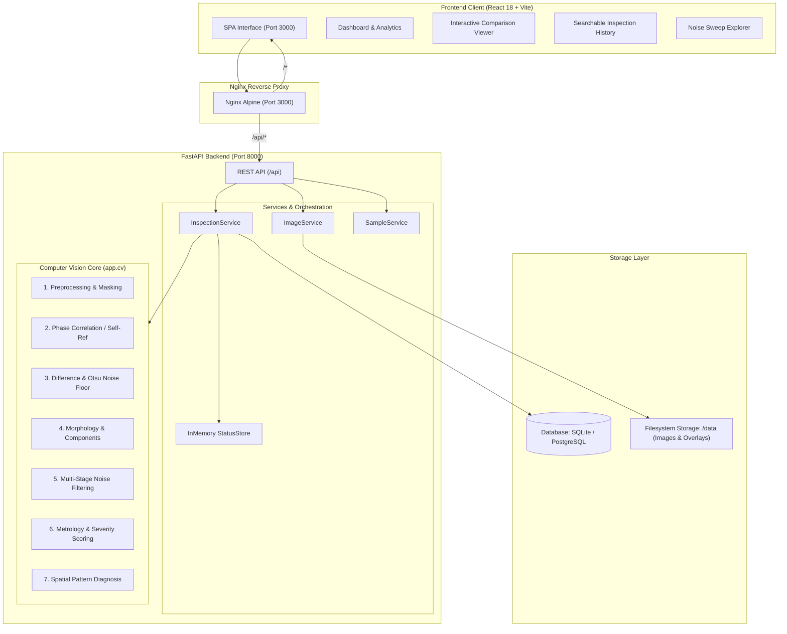
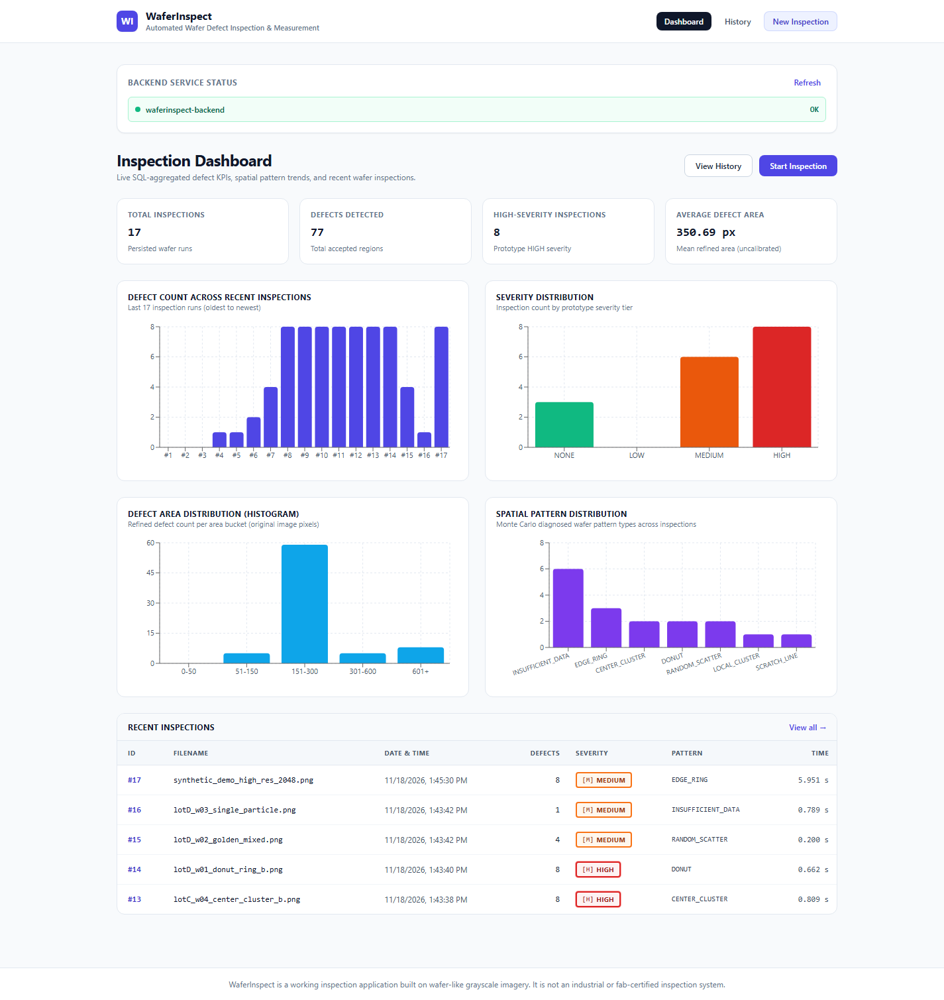
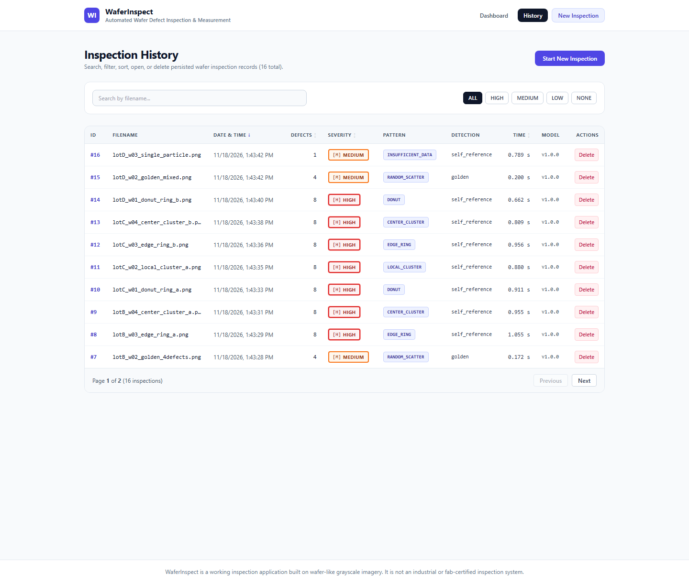
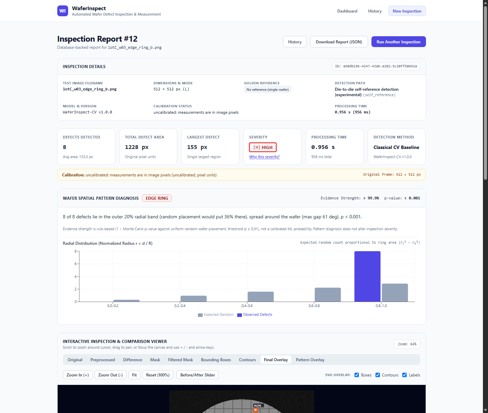
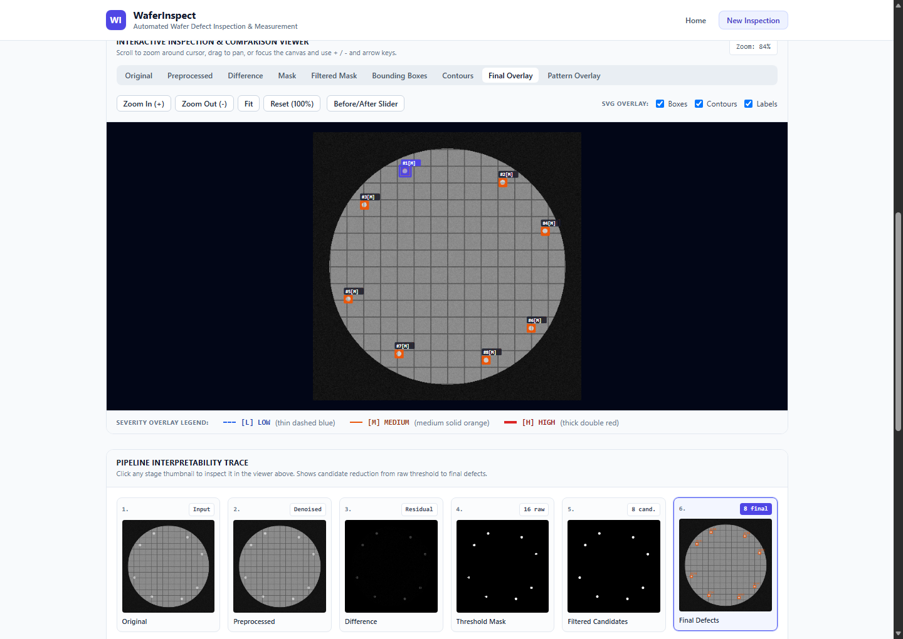
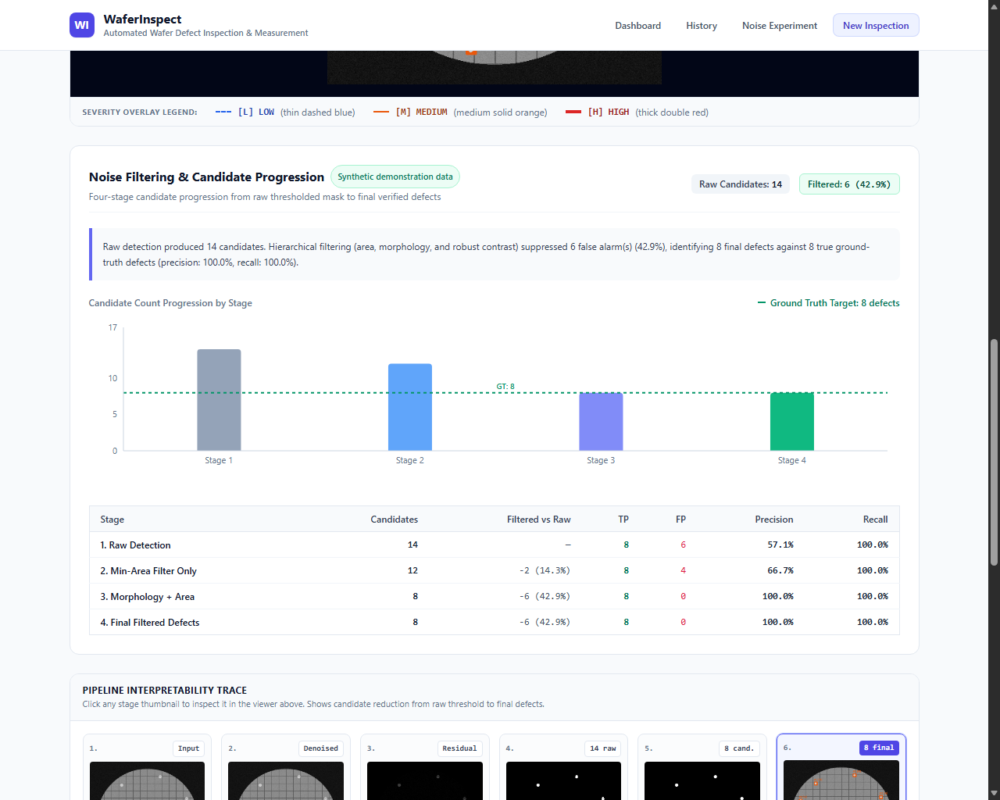
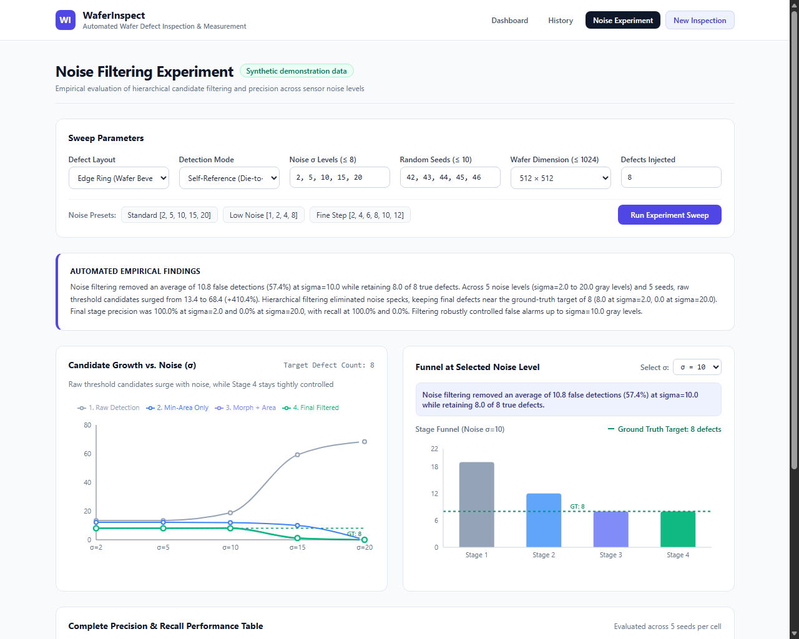
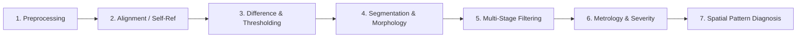

# WaferInspect: Die-to-Database Automated Wafer Defect Inspection System

[](https://github.com/R-Adhiya/Wafer_Inspect/actions/workflows/ci.yml)
[](https://www.python.org/)
[](https://nodejs.org/)
[](https://fastapi.tiangolo.com/)
[](https://react.dev/)
[](https://www.docker.com/)
[](LICENSE)

WaferInspect is an automated computer vision inspection and defect classification platform tailored for semiconductor wafer images. The system provides sub-pixel alignment, adaptive die-to-die self-referencing, multi-stage noise filtering, geometric metrology, spatial defect pattern recognition, and persistent inspection history tracking.

---

## Table of Contents

- [Overview & Problem Statement](#overview--problem-statement)
- [System Architecture](#system-architecture)
- [Interactive UI Screenshots](#interactive-ui-screenshots)
- [Seven-Stage Inspection Pipeline](#seven-stage-inspection-pipeline)
- [Evaluation & Benchmark Results](#evaluation--benchmark-results)
- [REST API Reference](#rest-api-reference)
- [Known Limitations](#known-limitations)
- [Roadmap & Future ML Enhancements](#roadmap--future-ml-enhancements)
- [Local Installation & Development](#local-installation--development)
- [Docker Deployment](#docker-deployment)
- [License](#license)

---

## Overview & Problem Statement

Semiconductor automated optical inspection (AOI) demands ultra-high sensitivity to minute defects (particles, scratches, voids) while maintaining near-zero false positive rates on noisy sensor imagery. Traditional manual inspection cannot scale, while unconstrained global thresholding on high-resolution wafers bisects the background sensor noise, flooding downstream review stations with thousands of false alarms.

WaferInspect addresses these challenges with a deterministic, mathematically grounded vision pipeline:
- **Die-to-Die Self-Referencing**: When no pristine "golden" wafer template exists, WaferInspect estimates die periodicity using 2D FFT autocorrelation and synthesizes local references dynamically from the median of surrounding die neighbours.
- **Statistical Noise-Floor Bounding**: Gating Otsu thresholding with a folded Median Absolute Deviation (MAD) ceiling ($k \cdot \sigma$) eliminates noise flooding on clean wafers.
- **Multi-Stage Filtering**: Connected component analysis combined with morphological opening/closing, area thresholds, and contrast-to-noise gating rejects sensor artifacts while retaining delicate micro-scratches.
- **Spatial Pattern Diagnosis**: Monte Carlo spatial Poisson tests classify signatures (`EDGE_RING`, `CENTER_CLUSTER`, `DONUT`, `SCRATCH_LINE`, `LOCAL_CLUSTER`, `RANDOM_SCATTER`) to diagnose upstream fab equipment anomalies.
- **Enterprise Persistence**: Complete tracking across inspections, geometric defect tables, and pipeline execution logs in SQLite or PostgreSQL.

---

## System Architecture



For comprehensive architectural design and entity relationship diagrams, see [docs/architecture.md](docs/architecture.md).

---

## Interactive UI Screenshots

The WaferInspect web interface provides an interactive, responsive operator workspace:

| Dashboard & Fleet Analytics | Inspection History & Filtering |
|:---:|:---:|
|  |  |
| *Fleet-level defect counts, severity breakdowns, and pattern distribution.* | *Searchable, sortable, paginated run history with cascading delete.* |

| Inspection Report & Metrology | Comparison Viewer & Overlays |
|:---:|:---:|
|  |  |
| *Detailed metrics, pattern confidence, p-values, and defect metrology.* | *Smooth zoom/pan, before/after split slider, and defect contour overlays.* |

| Multi-Stage Noise Funnel Card | Noise Sweep Experiment Explorer |
|:---:|:---:|
|  |  |
| *Auditable candidate progression from raw threshold to accepted defect.* | *Empirical precision/recall evaluation across Gaussian noise $\sigma$ sweeps.* |

---

## Seven-Stage Inspection Pipeline



1. **Preprocessing & Wafer Mask Estimation**:
   Detects wafer boundary via circular Hough / Otsu disk masking, locating center $(c_x, c_y)$ and radius $r$. Normalizes illumination gradients using CLAHE when quadrant variance exceeds threshold. Enforces `MAX_IMAGE_DIMENSION=4096` to guarantee process memory remains $< 2\text{ GB}$.
2. **Reference Image Alignment / Self-Reference Synthesis**:
   - *Golden Reference*: Rigid translation registration via sub-pixel phase correlation (`cv2.phaseCorrelate`).
   - *Self-Reference (Die-to-Die)*: 2D FFT autocorrelation discovers integer die pitch $(p_x, p_y)$. Synthesizes a virtual reference for each pixel from the median of up to 8 surrounding dies. Pixels with $< 3$ valid neighbours are flagged as unverifiable border bands.
3. **Difference Computation & Noise Floor Gating**:
   Computes unsigned absolute difference with photometric illumination matching. Estimates robust sensor noise $\sigma = \text{median}(|D|) / 0.6745$ (MAD) and enforces a minimum Otsu noise floor $T \ge k \cdot \sigma$ ($k=3.5$).
4. **Segmentation & Connected Components**:
   Executes morphological opening (removes isolated pixel salt noise) followed by closing (bridges micro-fractures), then extracts 8-connected candidate regions.
5. **Multi-Stage Rule-Based Noise Filtering**:
   Applies minimum area filtering ($\ge 12\text{ px}$ default), contrast-to-noise gating ($k_{\text{contrast}} \cdot \sigma$), and geometric aspect-ratio / solidity checks. Logs audit reasons for each rejected candidate.
6. **Geometric Metrology & Severity Assessment**:
   Calculates polygon contours (`cv2.approxPolyDP`), minimum bounding area rectangle (`cv2.minAreaRect`), equivalent diameter, length, thickness, and orientation. Categorizes severity (`LOW`, `MEDIUM`, `HIGH`, `CRITICAL`).
7. **Spatial Pattern Diagnosis**:
   Maps defect centroids to normalized polar coordinates $(r/R, \theta)$. Performs Monte Carlo hypothesis testing against the spatial Poisson null distribution ($p \le 0.01$) to identify equipment signatures: `EDGE_RING`, `CENTER_CLUSTER`, `DONUT`, `SCRATCH_LINE`, `LOCAL_CLUSTER`, or `RANDOM_SCATTER`.

---

## Evaluation & Benchmark Results

All figures below are real empirical values measured across reproducible benchmarks on synthetic wafers:

### 1. Detection Accuracy ([docs/accuracy.md](docs/accuracy.md))
- **Recall**: **100.0%** on defects $\ge 12\text{ px}$ with contrast $\ge 30$, and defects $\ge 8\text{ px}$ with contrast $60$.
- **False Positives**: **0.000 FP/image** across all 1,800 test cells due to MAD noise-floor bounding.

### 2. Spatial Pattern Diagnosis ([docs/pattern_accuracy.md](docs/pattern_accuracy.md))
- At $n=8$ defects: **100.0% precision and 100.0% recall** across all six signature classes (`EDGE_RING`, `CENTER_CLUSTER`, `DONUT`, `SCRATCH_LINE`, `LOCAL_CLUSTER`, `RANDOM_SCATTER`) with a **0.0% false-pattern rate** on random scatter.
- At low defect counts ($n=3$): The strict $p \le 0.01$ significance gate classifies weak configurations as `RANDOM_SCATTER` (45% recall on edge ring) rather than hallucinating false equipment signatures.

### 3. Noise Filtering Breakdown ([docs/noise_experiment.md](docs/noise_experiment.md))
- At $\sigma \le 10.0$ gray levels: Multi-stage filtering achieves **100.0% precision and 100.0% recall** across both golden and self-reference paths.
- At high noise ($\sigma \ge 15.0$): Heavy noise fragments defect signal below Otsu thresholds; recall drops to 15.0% in self-reference and 0% at $\sigma = 20.0$.

### 4. Performance & Scalability ([docs/performance.md](docs/performance.md))
- **512×512 px**: Golden path runs in **0.087 s** (9.5 MB peak); self-reference runs in **0.248 s** (39.7 MB peak).
- **2048×2048 px**: Golden path runs in **0.858 s** (136.4 MB peak); self-reference runs in **3.474 s** (632.5 MB peak).
- **4096×4096 px**: Automatically downscales to `max_side=2048` (`scale=0.5`), reducing execution time from 16.02 s to **3.36 s** with $< 1\%$ measurement error on original coordinates.
- **8192×8192 px**: Enforces `MAX_IMAGE_DIMENSION=4096` to guarantee process memory remains safely $< 2\text{ GB}$.

---

## REST API Reference

| Endpoint | Method | Description | Status Codes |
| :--- | :---: | :--- | :--- |
| `/health` | `GET` | Health check and service status | `200` |
| `/samples` | `GET` | List available synthetic demo wafer samples | `200` |
| `/samples/{name}` | `POST` | Generate and upload synthetic sample wafer | `200`, `404` |
| `/inspection/upload` | `POST` | Upload test wafer and optional golden reference | `200`, `415`, `422` |
| `/inspection/run` | `POST` | Execute full CV inspection pipeline synchronously | `200`, `404`, `409`, `422` |
| `/inspection/run/{upload_id}/status` | `GET` | Live in-memory pipeline stage status | `200`, `404` |
| `/inspection/run/{upload_id}/result` | `GET` | Retrieve saved run result JSON | `200`, `404`, `409` |
| `/inspection/history` | `GET` | Filterable, sortable, paginated inspection runs | `200` |
| `/inspection/{id}` | `GET` | Full inspection report by database ID | `200`, `404`, `409` |
| `/inspection/{id}` | `DELETE` | Cascade delete inspection, database rows, and image files | `200`, `404` |
| `/inspection/{id}/defects` | `GET` | Paginated defect table with geometric metrology | `200`, `404` |
| `/inspection/{id}/images` | `GET` | URLs of all 9 intermediate and overlay images | `200`, `404` |
| `/inspection/{id}/image/{kind}` | `GET` | Serve raw image file (`original`, `final_overlay`, etc.) | `200`, `404` |
| `/inspection/{id}/noise-experiment` | `GET` | Four-stage noise filtering candidate breakdown | `200`, `404` |
| `/dashboard/stats` | `GET` | Aggregated fleet metrics, severity, and histograms | `200` |
| `/experiments/noise-sweep` | `POST` | Multi-seed noise sweep benchmark across $\sigma$ levels | `200`, `422` |

---

## Known Limitations

1. **Wafer-Edge Margin Under-Measurement**: Defects intersecting the wafer boundary measure approximately 15–20% smaller in area because the circular wafer mask clips defect pixels extending outside the active wafer aperture.
2. **Low-Contrast Micro-Scratches**: Scratches with mean intensity contrast $\le 15$ gray levels fall below the robust noise floor ceiling ($3.5 \cdot \sigma$) in high-noise environments ($\sigma \ge 10.0$).
3. **Tentative Calls on Low Defect Counts ($n < 5$)**: Spatial statistical tests require sufficient evidence to reject the Poisson random null. Patterns detected with $n \in \{3, 4\}$ defects carry a low-count cautionary advisory.
4. **Blanket / Unpatterned Wafers**: Self-reference die-to-die detection requires periodic repeating dies. On blanket unpatterned wafers, the pipeline automatically falls back to masked Gaussian background subtraction.

---

## Roadmap & Future ML Enhancements

- **Deep Learning Patch Classifier**: The database schema reserves `model_name`, `model_version`, and defect classification columns (`classification_label`, `confidence`). Classical CV serves as the initial high-recall candidate proposal generator, with an upcoming PyTorch CNN patch classifier designed to refine subtle defect classifications.
- **Distributed Status Store**: Transition in-memory `StatusStore` to Redis for multi-worker container scaling.
- **Multi-Die Array Defect Clustering**: Cluster die-level defect density maps into cross-wafer yield loss patterns.

---

## Local Installation & Development

### Prerequisites
- Python 3.12+
- Node.js 20+ and npm

### Backend Setup
```bash
# 1. Create and activate virtual environment
python -m venv venv
# Linux/macOS:
source venv/bin/activate
# Windows PowerShell:
.\venv\Scripts\Activate.ps1

# 2. Install dependencies
pip install -r backend/requirements.txt

# 3. Run database migrations
alembic -c backend/alembic.ini upgrade head

# 4. Start backend API server
uvicorn app.main:app --app-dir backend --reload --port 8000
```

### Frontend Setup
```bash
# 1. Navigate to frontend
cd frontend

# 2. Install dependencies
npm ci

# 3. Start development server
npm run dev
```

### Running Tests & Linting
```bash
# Run backend tests with coverage enforcement (fail-under 88%)
pytest backend/tests -v --cov=app --cov-report=term --cov-fail-under=88

# Run backend linter and format checks
ruff check backend
ruff format --check backend

# Run frontend test suite and production build
npm --prefix frontend test
npm --prefix frontend run build

# Run end-to-end smoke test against running backend
python scripts/smoke_test.py --base-url http://localhost:8000
```

---

## Docker Deployment

WaferInspect supports single-command deployment with zero configuration via Docker Compose.

### 1. Default SQLite Deployment (Zero Setup)
```bash
docker compose up --build -d
```
- **Frontend SPA**: `http://localhost:3000`
- **Backend API**: `http://localhost:8000`
- **Data Persistence**: Preserved in Docker volume `wafer_data` mounted at `/data`.

### 2. Production PostgreSQL Deployment
```bash
docker compose --profile postgres up --build -d
```
Spins up PostgreSQL 16 along with the backend and frontend. The backend automatically applies migrations via Alembic on startup.

### 3. Verifying Container Health
```bash
# Run smoke test through frontend reverse proxy
python scripts/smoke_test.py --base-url http://localhost:8000
```

To stop containers:
```bash
docker compose down -v
```

---

## License

This project is licensed under the terms of the MIT License. See [LICENSE](LICENSE) for details.
