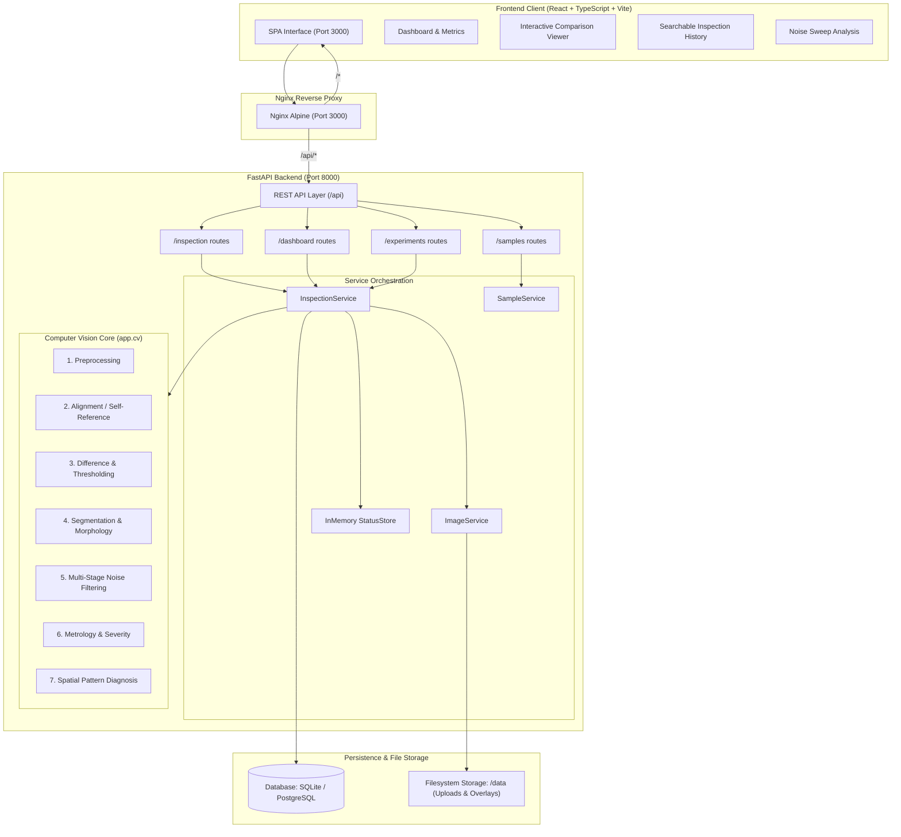
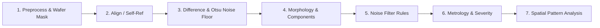
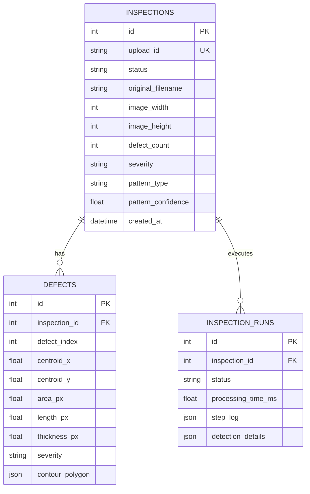

# WaferInspect System Architecture & Pipeline Specification

## 1. System Overview

WaferInspect is an automated computer vision inspection and defect classification platform tailored for semiconductor wafer images. The system provides sub-pixel alignment, adaptive die-to-die self-referencing, multi-stage noise filtering, geometric metrology, spatial defect pattern recognition, and persistent inspection history tracking.

---

## 2. Seven-Stage Inspection Pipeline

The core detection engine executes a deterministic, multi-stage pipeline designed to minimize false positives from sensor noise while preserving delicate micro-defects and scratches:

### Stage 1: Preprocessing & Wafer Disk Mask
- **Wafer Boundary Detection**: Computes circular wafer mask via Otsu thresholding, morphological closing, and contour convex hull fitting, identifying center `(cx, cy)` and radius `r`.
- **Contrast & Illumination Normalization**: Evaluates quadrant intensity gradients; applies CLAHE (clip limit 2.0) if quadrant variance or global contrast indicates non-uniform lighting.
- **High-Resolution Dimension Management**: Safely enforces `MAX_IMAGE_DIMENSION=4096` to guarantee peak memory remains under 2 GB. Images exceeding 2048 px use documented scale factors mapped back to original coordinates.

### Stage 2: Reference Image Alignment / Self-Reference Synthesis
- **Golden Reference Path**: Performs sub-pixel image registration via phase correlation (`cv2.phaseCorrelate`). Computes rigid translation vector and warps reference to test image coordinate frame.
- **Self-Reference Path (Die-to-Die)**: For patterned wafers without a golden template, runs 2D FFT autocorrelation to automatically determine die pitch $(p_x, p_y)$. For each valid pixel, synthesizes a local reference from the median of up to 8 surrounding die neighbours. Pixels lacking $\ge 3$ valid neighbours are marked unverifiable border zones rather than guessed.
- **Fallback**: Gracefully falls back to masked Gaussian background subtraction when periodicity is absent.

### Stage 3: Difference Computation & Robust Noise Floor Thresholding
- **Photometric Matching**: Corrects global illumination drift between test and reference before computing unsigned absolute difference.
- **Noise Estimation**: Robustly estimates noise variance $\sigma$ using folded Median Absolute Deviation (MAD):
  $$\sigma = \frac{\text{median}(|D|)}{0.6745}$$
- **Noise Floor Ceiling Guard**: Otsu thresholding is lower-bounded by $T_{\text{noise}} = k \cdot \sigma$ ($k=3.5$). This prevents Otsu from bisecting background noise on wafers containing no genuine defects.

### Stage 4: Segmentation & Morphological Cleaning
- **Morphological Operations**: Executes opening (removes single-pixel isolated noise) followed by closing (bridges tiny gaps inside defects).
- **Connected Component Analysis**: Extracts candidate 8-connected components and extracts pixel boundaries and bounding boxes.

### Stage 5: Rule-Based Noise Filtering
- **Size Filtering**: Rejects candidates with pixel area $< \text{min\_area\_px}$ (default 5 px).
- **Contrast Guard**: Compares mean candidate defect contrast against noise-derived limit ($k_{\text{contrast}} \cdot \sigma$).
- **Geometric Sanity**: Optionally rejects unphysical shapes via solidity and aspect ratio limits while maintaining high sensitivity to long, thin scratches.
- Records all rejected candidates with specific diagnostic rule names for full auditability.

### Stage 6: Geometric Metrology & Severity Assessment
- **Geometric Metrics**: Computes exact contour polygon approximations (`cv2.approxPolyDP`), minimum bounding area rectangle (`cv2.minAreaRect`), equivalent diameter, major/minor axis lengths, orientation angle, and elongation ratio.
- **Severity Classification**: Categorizes each defect as `LOW`, `MEDIUM`, `HIGH`, or `CRITICAL` based on calibrated micron-scale dimensions, wafer area coverage percentage, and proximity to critical regions.

### Stage 7: Wafer-Level Spatial Pattern Diagnosis
- **Normalized Coordinate Mapping**: Maps defects to normalized polar coordinates $(r/R, \theta)$.
- **Hypothesis Testing**: Computes Monte Carlo empirical p-values against the spatial Poisson null distribution (uniform spatial scatter).
- **Signature Classifiers**:
  - `EDGE_RING`: Radial concentration in the outer wafer margin ($r \ge 0.85 R$).
  - `CENTER_CLUSTER`: Concentrated defects in the core ($r \le 0.35 R$).
  - `DONUT`: Defect band concentrated in intermediate annulus ($0.35 R \le r \le 0.75 R$).
  - `SCRATCH_LINE`: High collinearity and high elongation ratio along a linear trajectory.
  - `LOCAL_CLUSTER`: DBSCAN-based local spatial defect density aggregation.
  - `RANDOM_SCATTER`: Spatial distribution conforming to Poisson random scatter ($p \ge 0.05$).
  - `INSUFFICIENT_DATA`: Flagged when defect count $< 3$ with low-count warnings for $n \in \{3, 4\}$.

---

## 3. Database & Storage Architecture

The persistence model supports both lightweight zero-configuration SQLite for local runs and PostgreSQL for production concurrency:

