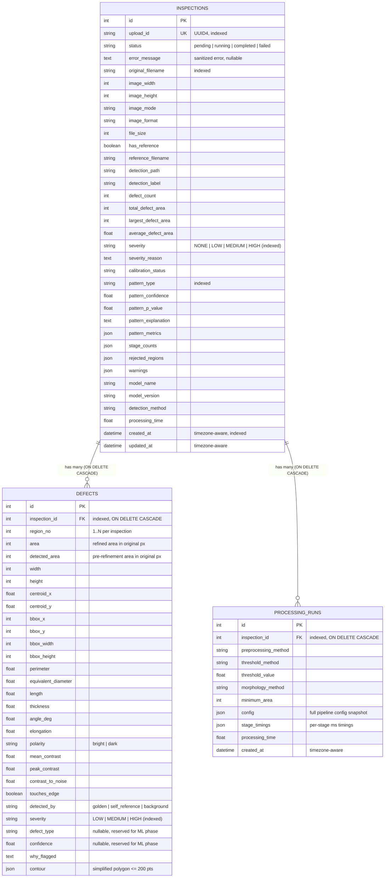

# WaferInspect Relational Database Schema

WaferInspect uses **SQLAlchemy 2.0** and **Alembic** migrations with strictly database-portable column types (`Integer`, `String`, `Float`, `Boolean`, `Text`, `DateTime(timezone=True)`, `JSON`). It runs on SQLite out of the box (`data/waferinspect.db`) and switches cleanly to PostgreSQL via `DATABASE_URL`.

## Entity-Relationship Diagram



## Indexes & Constraints

- **Foreign Keys**: `defects.inspection_id` and `processing_runs.inspection_id` reference `inspections.id` with `ON DELETE CASCADE`. SQLite enforces `PRAGMA foreign_keys=ON` and `PRAGMA journal_mode=WAL` on every connection.
- **Indexes**:
  - `inspections.upload_id` (unique)
  - `inspections.status`, `inspections.severity`, `inspections.pattern_type`, `inspections.created_at`, `inspections.original_filename`, composite `(status, created_at)`
  - `defects.inspection_id`, `defects.severity`, composite `(inspection_id, region_no)`
  - `processing_runs.inspection_id`

## Running Migrations

```bash
# Apply all Alembic migrations to the configured DATABASE_URL
alembic -c backend/alembic.ini upgrade head
```

Development startup (`backend/app/main.py`) invokes the exact same Alembic migration path automatically.
